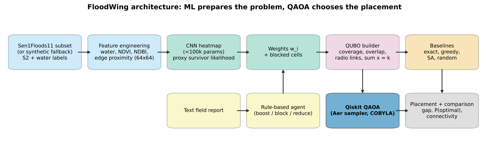

# FloodWing

Hybrid CNN + agent + QAOA drone placement for flood search-and-rescue.
Qiskit Fall Fest 2026 | Domain: UAVs & Robotics (Disaster Response).

After a flood, a rescue coordinator has `k = 4` drones and a 3x4 grid of candidate hover cells.
A small CNN predicts a survivor-likelihood heatmap from Sen1Floods11 Sentinel-2 flood features.
A rule-based agent updates that heatmap from plain-text field reports (boost, block, reduce).
The placement is written as a QUBO (coverage, footprint overlap, radio links, exactly k drones) and solved with Qiskit QAOA.
QAOA is compared with exact brute force, greedy, simulated annealing and random placements. No quantum speedup is claimed.



## Kaggle quickstart

1. Create a new Kaggle notebook and import `notebook/floodwing_kaggle.ipynb` (File > Import Notebook).
2. In the right panel, set **Internet: ON**. Accelerator can stay on CPU (GPU is used for the CNN if present).
3. Run All. The notebook installs the pinned Qiskit stack, writes the `floodwing` package to
   `/kaggle/working/floodwing_pkg` with `%%writefile` cells, downloads the Sen1Floods11 subset and runs every section.
4. Outputs land in `/kaggle/working/results/` (figures, tables, `summary.json`, `figures.zip`).

`FAST_MODE = True` (default) runs 24 chips, 8 instances and short QAOA budgets. Set `FAST_MODE = False` in Section 1.2 for 60 chips,
20 instances, 3 QAOA restarts and depth `p = 1..4`. To skip the download entirely, pass `use_synthetic=True` to `Config`.

## Local quickstart

```bash
pip install -r requirements.txt
python -c "import sys; sys.path.insert(0, 'src'); from floodwing.pipeline import run_all; from floodwing.config import Config; run_all(Config(fast_mode=True))"
pytest -q                                   # 14 unit tests
python tools/build_notebook.py              # regenerate the notebook from src/ after code changes
python tools/results_table.py --write       # refresh the results table below from results/tables/summary.csv
```

The one-liner reproduces every table, figure and `results/summary.json`. Python 3.10+ (tested on 3.13; Kaggle uses 3.11).

## Expected runtime

| Mode | Reference run (2-core CPU sandbox) | Target on Kaggle CPU |
| --- | --- | --- |
| `FAST_MODE=True` | about 5 minutes end to end | under 30 minutes |
| `FAST_MODE=False` | not timed here (about 6x more QAOA work) | under 90 minutes |

The slowest stages are the noise study (Aer trajectories at 4096 shots) and the optimizer comparison (SPSA uses about 4x more evaluations).
A time budget in `Config` (`time_budget_fast_s`, `time_budget_full_s`) skips remaining bonus experiments and logs it if a run is slow.

## Results (reference run, `FAST_MODE=True`, seed 42)

<!-- RESULTS_TABLE_START -->
| Method | Mean gap | Median gap | Ties / losses vs exact | Valid | P(valid) | P(optimal) | Connected to base | Evaluations | Time / instance |
| --- | --- | --- | --- | --- | --- | --- | --- | --- | --- |
| Exact | 0.00% | 0.00% | 8 / 0 | 100% | n/a | n/a | 100% | 495 | 0.001 s |
| QAOA | 0.94% | 0.00% | 6 / 2 | 100% | 0.516 | 0.0012 | 100% | 32 | 2.289 s |
| QAOA-shots | 55.64% | 58.59% | 0 / 8 | 100% | 0.521 | 0.0007 | 100% | 32 | 2.289 s |
| QAOA-best-sample | 0.00% | 0.00% | 8 / 0 | 100% | 0.521 | 0.0007 | 100% | 32 | 2.289 s |
| Greedy | 3.08% | 0.00% | 5 / 3 | 100% | n/a | n/a | 100% | 42 | 0.000 s |
| SA | 0.00% | 0.00% | 8 / 0 | 100% | n/a | n/a | 100% | 3000 | 0.118 s |
| Random | 58.47% | 57.94% | 0 / 8 | 100% | n/a | n/a | 75% | 1000 | 0.007 s |
<!-- RESULTS_TABLE_END -->

Gap is `(f - f*) / |f*|` against the exact optimum. Ties/losses count instances where a method matched or missed the optimum.
**QAOA** decodes the most probable valid bitstring of the exact statevector (simulator-only).
**QAOA-shots** decodes the most frequent valid bitstring in 4096 shots, which is what hardware would give.
**QAOA-best-sample** keeps the best valid bitstring among the 4096 shots. With only 495 valid placements, that is close to brute force.
**Random** reports the mean over 1000 random valid placements.

What the numbers say:

* QAOA (p = 2) lands on or very near the optimum on most instances, slightly ahead of greedy on average. The paired Wilcoxon test against greedy is **not significant** at this sample size (see `summary.json`).
* The standard X-mixer QAOA spends most of its effort on the `sum x = k` penalty. P(valid) is about 0.5 and P(optimal) is only a few times the uniform-guess level.
* Shot-based decoding is far worse than the exact read-out, because each of the 495 valid states holds roughly 0.1 to 0.3% of the probability.
* Warm-starting QAOA from the previous parameters after a field report converges in far fewer evaluations than a random restart.
* The Dicke-state + XY ring mixer keeps every sample valid (P(valid) = 1) and raises P(optimal), but its most probable state was not always the optimum at p = 2.

Every headline number above is in `results/summary.json`.

## Data

* **Sen1Floods11 v1.1**, hand-labelled chips (`S2Hand` Sentinel-2 13 bands, `LabelHand` water mask: -1 invalid, 0 dry, 1 water),
  public bucket `gs://sen1floods11`, read anonymously with `gcsfs`. Paths are found by listing the bucket at run time.
  Chips need at least 5% valid pixels and a flood fraction between 2% and 90%.
* **Synthetic fallback**: if the bucket is unreachable, chips are generated procedurally (smooth elevation, flood = low ground,
  building blobs, cloud gaps) with the same schema. The notebook prints which source was used.
* **Features** at 64x64: water fraction, NDVI, NDBI-like built-up proxy, flood-edge proximity. Pooled onto the planning grid.
* **Target is a proxy.** Sen1Floods11 has no survivor labels. Per cell:
  `target = clip(0.45 * flood_fraction + 0.35 * built_up + 0.20 * edge_proximity + N(0, 0.03), 0, 1)`.
  The CNN therefore learns a known function plus noise.

## Method

| Layer | What it does |
| --- | --- |
| CNN (`heatmap.py`) | 3 x Conv-BN-ReLU (16/32/64), adaptive pool to 3x4, 1x1 head, sigmoid. 23,905 parameters. MSE, Adam 1e-3, batch 8. |
| Agent (`agent.py`) | Regex + keyword parser. `parse_report(text, rows, cols)` returns `{cell, action, factor, confidence}`. `apply_updates` is pure. Optional local LLM behind `use_local_llm` (default OFF). |
| QUBO (`qubo.py`) | `f(x) = -sum w_i x_i + a sum O_ij x_i x_j - b sum C_ij x_i x_j + P (sum x - k)^2 + P_block sum_{i in B} x_i`, with `a = 0.6`, `b = 0.3`, `P = 2 (max w + a + b)`. Built as a `QuadraticProgram`, converted with `QuadraticProgramToQubo`, verified against an explicit matrix. |
| QAOA (`solvers.py`) | `qiskit_algorithms.QAOA`, p = 2, COBYLA (`rhobeg = 0.15`), Aer `SamplerV2` with 8192 shots per evaluation, linear-ramp initial point, Hamiltonian scaled by its largest coefficient. Final sample: 4096 shots. |
| Baselines (`solvers.py`) | Exact brute force (`C(12,4) = 495`, cross-checked with `NumPyMinimumEigensolver`), greedy marginal gain, simulated annealing with swap moves, random. One result schema for all. |

Design choices worth knowing:

* **Radio range is 2.25 cells, not 1.5.** With `R = 1.5` the radio matrix equals the 8-neighbour overlap matrix, so the overlap
  penalty and the link reward hit exactly the same pairs and partly cancel. At 2.25, adjacent drones are penalised and drones two
  cells apart are rewarded, which is the coverage-versus-connectivity trade-off the problem describes.
* **Blocked cells use a linear penalty** instead of removing the variable. The qubit-to-cell map stays fixed across agent updates,
  so a warm start reuses the same parameters on the same qubits.
* **Ramp initialisation uses negative beta.** With mixer `exp(-i beta sum X)`, annealing from `|+>` corresponds to
  `gamma_l = s_l dt`, `beta_l = -(1 - s_l) dt`. Positive-beta ramps started in a worse basin in our tests.
* **The base station** sits just north of cell A1. Connectivity to base is a post-hoc metric; the QUBO only rewards linked pairs.

## Bonus experiments

All in `bonus.py`, each behind a `Config` flag and wrapped so a failure is logged rather than fatal.

| # | Experiment | Figure |
| --- | --- | --- |
| 1 | QAOA depth `p = 1..3` (1..4 in full mode): gap, P(optimal), evaluations | `10_depth_study.png` |
| 2 | Penalty sweep `P x {0.25, 0.5, 1, 2, 4}`: P(valid), gap, QUBO ground-state validity | `11_penalty_sensitivity.png` |
| 3 | Warm start after an agent update vs random initialisation | `12_warm_start.png` |
| 4 | COBYLA vs SPSA vs Nelder-Mead | `13_optimizer_comparison.png` |
| 5 | Dicke state + ring XY mixer, custom `QuantumCircuit` + `ParameterVector` + SciPy loop | `19_xy_mixer.png` |
| 6 | Depolarising (0.1% 1q, 1% 2q) + 1% readout noise, scaled 0x to 4x | `14_noise_robustness.png` |
| 7 | p = 1 `(gamma, beta)` landscape with the COBYLA path | `15_landscape_p1.png` |
| 8 | Scaling probe, 8 to 16 qubits (statevector memory doubles per qubit) | `16_scaling.png` |

## Folder map

```
floodwing/
  README.md  CREDITS.md  requirements.txt  pytest.ini
  notebook/floodwing_kaggle.ipynb     # self-contained Kaggle notebook (generated by tools/build_notebook.py)
  src/floodwing/
    config.py      Config dataclass, seeds, device, version printout
    data.py        Sen1Floods11 download, synthetic fallback, features, proxy target
    heatmap.py     CNN, training, metrics, predictions
    agent.py       report parser, apply_updates, optional local-LLM parser
    qubo.py        PlacementProblem, QUBO matrix, QuadraticProgram, Ising, decode
    solvers.py     QAOA, exact, greedy, random, SA, primitive selection
    evaluate.py    instances, experiment loop, summary, Wilcoxon test
    bonus.py       bonus experiments 1-8
    viz.py         all figures and the GIF
    pipeline.py    stage functions and run_all(cfg)
    utils.py       logging, timing, JSON, cell naming
  tests/test_core.py                  # 14 pytest tests
  tools/build_notebook.py             # writes the notebook from src/
  tools/results_table.py              # README results table from summary.csv
  results/figures/*.png  results/tables/*.csv  results/summary.json
```

## Reproducibility

* Seed `42` for Python `random`, NumPy, PyTorch, the Aer sampler, SA and random baselines (`Config.seed`).
* The Qiskit stack is pinned exactly in `requirements.txt` and the notebook. Versions are printed in the first cell.
* `pytest -q` checks: QUBO matrix equals the `QuadraticProgram` on 50 random bitstrings; Ising diagonal equals the QUBO;
  exact is valid and not worse than greedy or SA; `decode` flags invalid bitstrings; parser handles valid, out-of-range,
  two-cell and no-cell reports; `apply_updates` does not mutate input; NumPy QAOA equals Qiskit statevector; the same seed gives
  the same QAOA result.

## Limitations

* 12 to 16 variables are solved exactly in milliseconds. There is **no quantum advantage claim**.
* With the standard X mixer, QAOA mostly learns the `sum x = k` penalty. P(optimal) stays a small multiple of uniform guessing at
  `p <= 3` and depends on the penalty weight (penalty sweep).
* The headline QAOA read-out uses the exact statevector distribution, which only a simulator has. The hardware-realistic
  QAOA-shots read-out is much worse. QAOA-best-sample is close to brute force and is not evidence of quantum quality on its own.
* The survivor likelihood is a **proxy**, not real survivor data. The CNN learns a known function plus noise.
* The pairwise radio reward does not guarantee a connected relay chain to base. The post-hoc connectivity rate is reported.
* The agent is a keyword parser and is brittle to unusual phrasing. A human confirmation step is needed in practice.
* Simulator and simple noise-model results do not predict real hardware behaviour. At 1% two-qubit error the 264-CX circuit loses
  most of its structure.
* Scaling beyond 16 qubits was not tested.
* The reference run in this repository used the **synthetic fallback**, because the build sandbox could not reach Google Cloud
  Storage. On Kaggle with Internet ON the notebook downloads Sen1Floods11; that path is implemented but was not executed here.

## Credits

Dataset and library credits, licenses and method references are in [CREDITS.md](CREDITS.md).
Sen1Floods11: Bonafilia et al., CVPR Workshops 2020, CC BY 4.0.
